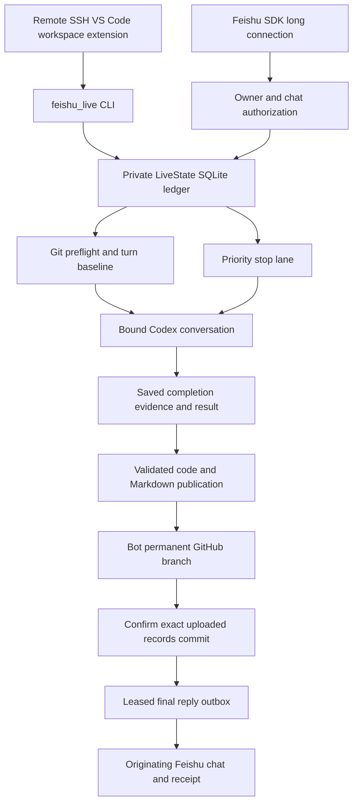

# Intern Agent architecture

## Boundaries and data flow

The frontend is `extension/extension.js`, a VS Code workspace extension running
on the Linux extension host, including Remote SSH. It invokes the bundled
Python CLI with argument arrays and a selected private `--state` directory.
It provides dialogs, an Explorer tree and controls; it does not implement a
second relay or own the conversation queue. Read-only dashboard refresh does
not create chats or agents. Auto-connect requires explicit opt-in and trust.

`feishu_live.py` connects the SDK event receiver and API adapter.
`live_state.py` validates the app, authenticated sender, group binding, input and
unique message identity before persisting work. Pairing is a deliberately
created one-time capability; arbitrary first-message ownership is rejected.
Revoked authorization is checked before execution. `runtime.py` is a separate
offline simulation using fake adapters, not a second production receiver.

Normal events wait for the bound conversation and workspace execution guards.
`workspace_tracking.py` validates the registered GitHub checkout, permanent
branch and published head, preserves pre-existing changes and captures a turn
baseline under the publication lock. Saved prompts enter the exact Codex
thread once. Original owner text stays unchanged; `prompt_context.py` supplies
bounded reference context separately. Unknown execution is held for inspection.
`progress.py` forwards eligible public commentary, not tool output or reasoning.

A completed result is saved before publication. Its official final reply enters
the leased frozen reply outbox only after confirmation of the exact uploaded
code/history commit. The thinking reaction remains through publication and reply
delivery. Public interim answers to live follow-ups can arrive while work
continues; they do not certify completion. Receipts survive restart; retrying
Git never reruns Codex or repeats an acknowledged answer. Ambiguous API send is
held for reconciliation.
`records.py`, `record_projection.py`, `bot_records.py` and Git guards validate
Markdown projections and eligible code. Task acceptance requires verified
published delivery, not merely a successful Feishu reply. See
[reply delivery](REPLY_DELIVERY.md) and [conversation lifecycle](CONVERSATIONS.md).

Attachments use `attachment_batches.py`, `attachments.py` and `file_transfer.py`:
uploads wait privately for the same sender's next ordinary message, which binds
one ordered batch. Downloads are bounded and ZIPs are inspected without extraction.
Requested outgoing files use immutable snapshots and a separate durable upload/send
worker, independent of code/history publication. A queued file is not delivered
until its receipt exists. See [file transfer](FILE_TRANSFER.md).

## Project and branch lifecycle

`project_init.py` previews the destination and saved steps; owner application
creates a new private GitHub repository, empty initial main baseline,
registration, isolated bot worktree/permanent branch, Codex console and chat.
Operation markers and saved stages prevent blind retries after ambiguous
external actions. Existing repositories use explicit attachment. No automatic
PR, merge, collaborator invitation or public visibility change occurs.

Each new bot uses one permanent branch for code and validated management records.
Named tasks are ledger entries and do not change branches. Bots have separate
worktrees and threads. Legacy bots retain their layout; no automatic migration
or historical session resumption belongs in contributor setup. See
[project initialization](PROJECT_INIT.md).

## Codex and tmux ownership

`session_hosts.py` provisions each managed conversation's private home, socket,
configuration and dedicated tmux session with Codex/host windows. Conversation
sessions use the user's default tmux socket; the catalog uses a separate private
socket. Dedicated sessions are not equivalent to a dedicated server for every
bot. Authentication stays private and is linked to the selected login home.
`codex_bridge.py` manages the app-server connection and exact saved thread.
An existing but unreachable host requires inspection rather than replacement.

`terminal_bridge.py` binds an existing native terminal only after checking its
pane, PID/start time, process ancestry, thread and rollout identity. It never
starts a second Codex for that thread or imports pre-attachment turns. Injection
requires an empty pinned input; drafts and menus block dispatch. Initial requests
wait for idle, while an ordinary owner follow-up can steer the exact active turn
with transcript-confirmed acceptance. Peer and timer input cannot use that path.
`console_observer.py` observes managed console activity. Upgrading the transcript
adapter requires revalidation against the supported CLI. See [terminal](TERMINAL.md).

## Persistence, recovery and upgrade

Private state contains configuration, pairing identity, queue/outbox/database,
receipts, health, Codex rollouts/hosts, immutable backend releases, project
checkouts/worktrees and file snapshots. None belongs in reusable source or a
VSIX. The relay writes `.intern_workspace` projections in operational branches;
contributors must not manufacture or edit them as source preparation.

`/stop` uses a priority path and interrupts the pinned turn without discarding
completed actions. `/pause` holds dispatch. Saved-result recovery retries
publication/delivery; it never repeats the original request. Unknown execution,
uncertain send and missing baseline require reconciliation. `auto_recovery.py`
continues only confirmed transient failures under an explicit bounded policy;
`flow_watchdog.py` records genuine flow faults. Healthy long work stays quiet.
An incident operator is explicitly configured; no historical bot is adopted by
this audit. See [operator runbook](RECOVERY_OPERATOR.md) and [recovery](RECOVERY.md).

`deployment.py` prepares content-addressed private backend snapshots, separate
from extension installation. Activation checks protected preferences and idle
work. A new VSIX is not proof that an existing receiver changed versions. Preserve
threads, bindings and receipts, verify the selected snapshot, and use the
reviewed rollback procedure; never kill shared tmux or start a competing relay.
The source/deployed differences are recorded in [the audit](OPEN_SOURCE_AUDIT.md).
