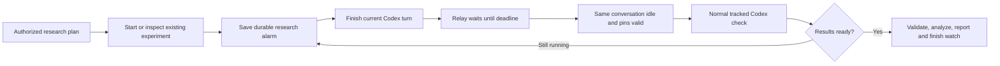

# Persistent research wake-ups

**Purpose:** return to an existing research conversation after a long background
experiment, even when Codex has finished its current turn and the owner is away.
An external relay scheduler remembers the deadline; Codex does not need to sleep,
remain busy, or receive another owner message.

**Prerequisites:** a ready registered GitHub workspace, its published bot branch,
an owner-paired Feishu chat and an existing Codex thread. The Linux host and relay
must remain running. No additional Feishu scope or Python package is needed.
Register an alarm only for an owner-authorized research plan. Cloning portable
history does not recreate executable alarms or authorize new compute.

## Use in Feishu

For an existing experiment estimated to need ten more hours:

```text
/research start 10h "Inspect the existing experiment, validate saved results and continue the authorized research plan" --every 1h --checks 12 --for 48h --key experiment-a --evidence runs/experiment-a/status.json
/research status
/help research
```

The first check is at least ten hours after registration. If Codex is busy then,
the alarm waits for that same conversation to become idle. Another bot's work
does not block an independently tracked checkout. A completed check schedules
the next one an hour after completion unless Codex records a better interval or
finishes the watch. Owner messages have priority over scheduled checks.

Use the actual remaining runtime estimate. Ten hours is an example, not a
default for every experiment. A partial lower-bound estimate is not a reliable
completion time; use a suitably spaced inspection and retain that uncertainty.
Repeated alarms are bounded by both the total check count and the time horizon.
Defaults: one-hour follow-ups, twelve checks, seventy-two-hour horizon. Supported
limits: one minute to thirty days, one to forty-eight checks, eight unfinished
watches per conversation and eight evidence paths per watch. The first check
must precede the horizon. Paths are relative references, not executable commands.

```text
/research defer WATCH_ID 2h --note "The existing worker has two hours remaining"
/research finish WATCH_ID --note "Validated final artifacts; report saved"
/research pause WATCH_ID
/research resume WATCH_ID
/research cancel WATCH_ID
```

`defer` postpones a check without extending the original horizon or check budget.
`resume` requires the same original task, branch and thread and remaining budget.
`/pause` also pauses that conversation's alarms; `/resume` does not silently
rearm them. `/stop` cancels queued prompts and research alarms for that
conversation, and interrupts its current Codex turn. It does not kill unrelated
background training processes or undo completed work. Finished, cancelled or
exhausted watches require a new owner-authorized plan rather than a hidden reset.

In Control, these commands default to its own conversation; put a registered
session after `/research` to manage another bot. The VS Code preview adds
**Manage Research Wake-ups** and shows active watches and their UTC deadlines
under each conversation in the dashboard.

## Agent integration and the research pipeline

The existing submit hook supplies a context-bound local research tool separately
from the unchanged owner message. When an authorized experiment outlives the
current turn, Codex should register its next check **before** returning, using a
stable experiment key, real evidence paths and finite resource/check limits.
It must inspect `research status` and report the saved deadline; promising to
check later without registering an alarm does not schedule anything.



The tool syntax, with the private command prefix supplied by the hook, is:

```text
research --context CONTEXT_FILE start 10h "Inspect this existing experiment" --every 1h --checks 12 --for 48h --key experiment-a --evidence runs/experiment-a/status.json
research --context CONTEXT_FILE status
research --context CONTEXT_FILE defer WATCH_ID 2h --note "Observed remaining runtime"
research --context CONTEXT_FILE finish WATCH_ID --note "Evidence and result"
```

Only the originating conversation may use its context. A scheduled check can
finish or defer its own watch; it cannot create replacement watches or enlarge
its budget. Peer mail and recovery incidents cannot authorize autonomous
research. An explicitly registered native-terminal watch uses the existing
attachment; this does not enable automatic incidents or ordinary wake-ups in
manual Debug Bot. Native hook trust remains a separate setup requirement.

An overdue watch queues one new check, not the original owner prompt. It uses the
normal Git/workspace preflight, unique Codex console, progress, saved answer,
file-transfer and reply-delivery paths. A timer neither creates a new thread nor
restarts an experiment. The check inspects processes, saved job identities,
logs, completion markers and artifacts before deciding the next permitted step.
Completion of a process is not scientific success or publication readiness.
New compute outside the prior plan, larger resource budgets and account changes
still need owner authorization.

## Persistence, history and recovery

Executable alarms, pinned ownership/thread/task/branch and dispatch associations
are private SQLite state. Each alarm reserves one durable event per check in a
transaction. Relay downtime produces one overdue inspection after restart, not
a burst of missed hourly checks. Unknown execution is held for review and never
replayed merely because a clock expired. A task/branch change pauses the alarm;
ownership/thread changes supersede it. Existing jobs remain untouched.

Claiming a queued check is separate from entering Codex. A durable dispatch
boundary records which of these happened. If a preflight worker fails before
that boundary, the same saved event retries up to three times with a short
backoff, yielding to owner input. It does not consume another research check.
After repeated failures it requires preflight review. A restart can restore a
proven unstarted claim; attempted execution and legacy rows without proof remain
uncertain and cannot be replayed automatically. Error diagnostics retain only
the exception category and SQLite error code, never raw exception details.

An observed transient Codex failure uses the existing bounded same-thread
[recovery process](AUTO_RECOVERY.md). The watch follows its exact continuation
chain and waits instead of scheduling competing work. Uncertain execution,
permanent failures and repeated observation failures require review. The
existing flow/recovery monitor directs runtime incidents to Recovery Sentinel,
not manual Debug Bot. Healthy waiting produces no periodic Feishu warning.

The plan, deadlines, finite budgets, check associations and append-only lifecycle
are also projected to validated Markdown under
`.intern_workspace/features/research_watch/`. Normal recorded turns contain the
actual check and its answer. These documents upload on the bot's existing
registered branch and recover as reference history; importing them does not
rearm the private scheduler. No second branch, PR or automatic merge is added.

## A completed check with no Feishu reply

Inspect Codex completion, console acknowledgement, saved reply, Git status and
the research alarm separately. A completed Codex check is not a network failure
and must not be repeated to repair its reply. An unresolved console pending
marker can hold delivery and the next alarm even when the backend is idle.

Research context is reference data sent separately from the unchanged request.
The producer and both transcript observers share the supported-context registry.
Only correctly wrapped, provenance-tagged references are skipped while matching
the exact dispatched request; owner lookalikes and unknown references still
require review. A producer cannot publish an unregistered reference key. This
prevents a new reference field from being mistaken for changed user input after
Codex has already executed it.

After a supported observer repair, read the original transcript through its
saved boundary. The normal reply outbox can deliver the already saved answer
and the existing alarm can continue within its original budget. Do not erase a
Git review, reset a cursor to EOF, resend an accepted research prompt or restart
training to make a waiting status disappear. Regression coverage includes the
actual published research references, exact prompt acknowledgement, saved
answer delivery once and subsequent alarm state for both observer adapters.

**Expected result:** status lists a saved watch and UTC next-check time. At or
after that time, an idle Codex conversation inspects the existing work and sends
its resulting answer to the same Feishu group. Busy work continues undisturbed.

**Verification:** regression checks exercise delayed delivery, reopening state,
concurrent ticks, owner priority, busy backend guards, cancellation, bounded
recurrence, deferral/completion, task/thread isolation, unknown execution and
the matching recovery chain. Offline tests do not imply that a particular
ten-hour experiment has finished or that a powered-off server can wake itself.

**Limits:** this is a durable research continuation scheduler, not a training
cluster scheduler or an unlimited goal loop. Background job launch/resource
enforcement remains the research workspace's responsibility. Exact wake time
can be later because of server downtime, active work, execution review, model
capacity or Git preflight. Status distinguishes scheduled, queued, running,
paused, completed, exhausted and review-needed states; queued is not proof Codex
received the check. File delivery still requires its own saved receipt.
