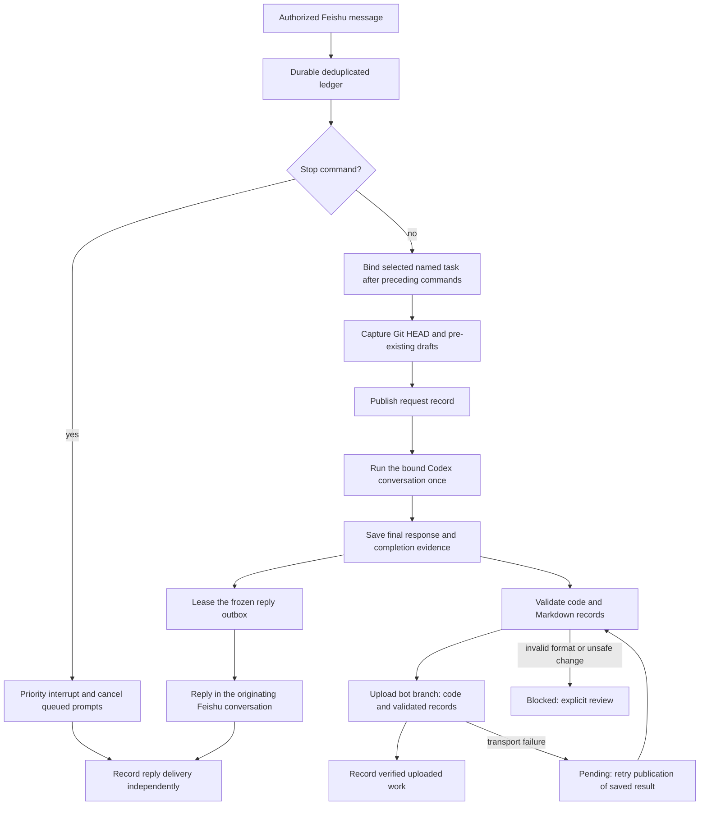

# Conversations, named tasks and immediate stop

The preview restores workspace memory, named tasks and
recovery from Git. See [recovery and memory](RECOVERY.md) for reconnecting on a
fresh machine. The old enterprise implementation is a behavioral reference;
its Codeup integration, native hooks and PR playbooks are not installed.

A repository can contain several conversations and several named tasks. Each
conversation has a separate **mode** and **agent activity**. Idle means no task
is selected; its messages are still recorded. Working means a named task is
selected; it can be waiting for your next message without an agent running.
The repository stays working while any conversation has a selected task.

| Axis | Values | Meaning |
| --- | --- | --- |
| Conversation mode | idle, working | Whether a named task is selected |
| Agent activity | waiting, running, awaiting_approval, stop_requested, stopped, completed, failed, unknown | Execution state, independent of the task |
| Named task | planned, active, paused, blocked, completed, cancelled | User-directed task lifecycle |
| Git sync | pending, synced, blocked | Whether records can be published |

## Codex consoles

Messages go to the conversation's own Codex terminal. An idle conversation can
receive input while another bot is working, even in the same GitHub repository.
Each conversation has one input worker. Ordinary owner text sent while Codex is
working steers that same active turn, without cancelling it or starting another
task. Input is durably saved before sending; this does not put bots in a shared
execution queue. See [live follow-ups](#live-follow-ups).

## Live follow-ups

Send additional instructions normally while your bot works. For example:

```text
Keep the current experiment running. Use the held-out results for the next table.
```

The relay submits your exact text to the active Codex turn and confirms
acceptance in the same Feishu chat. Codex incorporates the update when it can
next process input; an already running tool or job is not cancelled, and past
actions are not undone. An earlier reply can be finished while a subsequent
automatic monitoring turn is already active; the acceptance notice refers to
the currently running turn, not necessarily the previous owner request.

Public answers to accepted follow-ups are forwarded as soon as Codex writes
them, including while the same turn continues monitoring a background job.
They include the observed quota footer. A written answer does not manufacture
a completed turn: thinking reactions, Git delivery and task acceptance still
wait for the authoritative shared completion. An identical final answer is
not sent again at that completion; a later changed result is delivered normally.
An ambiguous send remains held for review without replaying Codex or the answer.

Use `/queue TEXT` when you intentionally want a separate later task. `/stop`
still requests cancellation. Slash commands remain relay commands; model/Fast
changes keep their existing next-turn behavior.

Managed consoles use Codex's `turn/steer` with the exact active turn ID.
Attached native terminals use their normal Enter submission only when the
pinned pane has an empty input; a user draft is preserved. Native acceptance
requires the exact input in the new transcript. No prompt wrappers are added.
Owner text is the only automatic steering source: peer mail, timers, recovery
and team handoffs retain their existing scope and ordering. A read-only peer
inspection cannot be repurposed into owner execution mid-turn.

If the turn ends before input is accepted, the saved request starts normally
afterward. An unknown send is held for review rather than resent. File-bearing
messages retain normal attachment preparation and start after the current turn;
this first steering path handles text. Input, acceptance and shared completion
remain separate evidence in Markdown history, on the same bot branch. No PR is
created. A linked follow-up does not independently rerun Codex or publish code.
If the parent reply is delivered before Git finishes, the follow-up releases
its execution lane and inherits that pending/blocked Git status. It cannot hold
the very parent publication it is waiting for. Later reconciliation updates the
linked history without a separate execution or child upload.

Registered bots with different checkouts and branches run independently. Bots
that actually share a checkout or branch retain exclusive execution. A bot's
Git snapshot and upload use its checkout lock; legacy shared history branches
still serialize updates to those shared records. Existing prompts are unchanged.

Already-delivered monitoring reports awaiting Git updates yield to a new owner
question in that same chat. Their saved answers, receipts and pending Git
retries remain intact; an old retry cannot repeatedly jump ahead of that queued
question. An in-flight Git operation finishes under its existing lock. The new
question then passes normal workspace/branch validation and its own baseline
before reaching Codex. Undelivered answers, uncertain execution and existing
reviews retain their safeguards. Internal timers and peer notes do not acquire
this owner priority.

If an automatic monitoring turn starts during Git preflight, a refusal before
`turn/start` is deferred or routed into that active turn. It is never presented
as a completed answer. Original owner text stays unchanged. The compatibility
repair for the old adapter archives its busy diagnostic and delivery receipt
before restoring input, and requires positive evidence that the input was not
sent. A previously observed request, an existing review or a completed immutable
record is not automatically reopened.

Every managed conversation has its own Codex process, private home/socket and
visible tmux session with `Codex` and `host` windows. `tmux ls` lists them;
`/console` returns its attach command and `/consoles` in management lists all.
The existing native Debug Bot stays in its original terminal. The receiver is
shared transport; it does not share conversation execution. A paused untracked
pilot remains a read-only history view until explicitly bound and resumed.
Direct console work also marks the conversation busy: task/branch selection
waits for completion, and Git snapshots wait for an idle console. Direct code
changes without a verified starting Git baseline still require review before
upload. See [operation and console safety](LIVE.md#recovery-and-operation).

## Commands

Automatic failure recovery uses `/recovery status|on|off|inbox`. After repairing
an escalated incident, `/recovery retry INCIDENT` rearms one bounded cycle.
Control can target another bot with `/recovery SESSION ACTION`.
See [automatic recovery and Recovery Sentinel incidents](AUTO_RECOVERY.md) for the
same-thread continuation, cancellation, backoff and communication rules.

In a workspace conversation:

```text
/task start Fix the relay pipeline
Explain the existing queue.
Now implement the change.
/task rename Reliable relay pipeline
/task status
/task pause
/task list
/task use nt_ID_FROM_LIST
/task finish
/chat
/stop
/help
```

**New bots use one permanent `intern-agent/WORKSPACE/BOT_ID` branch.** Code,
validated Markdown status, conversation history and recovery archives live
together on that branch. Named tasks remain records: start, rename, pause,
resume, `/chat` and finish never create or switch branches. Each bot uploads
only its own branch; it does not upload a shared management branch. Each branch
carries a snapshot of workspace/team records at that bot's latest upload.
Bots have isolated worktrees. Completed task changes remain in the bot's worktree
when another named task starts; task isolation is in the ledger, not Git branches.

Existing bots retain the earlier management/task-branch layout and its recovery
behavior. No branch is deleted or silently migrated. In that legacy layout,
task selection still switches between the saved task branch and home branch.
An unworked named task may be explicitly assigned to another bot; a task with
recorded agent work needs an explicit new handoff task to preserve its source.

`/task criteria TEXT` records acceptance criteria and `/task note TEXT` saves
task knowledge. `/task finish [NOTE]` is explicit owner acceptance of delivery
on the branch. It requires the latest non-legacy task turn to be completed,
synced, observed by the Codex adapter, and at the published delivery commit.
Dirty files, interrupted turns and unpublished commits block completion. The
receipt contains the accepted commit, owner note and timestamp. This verifies
delivery; the owner must assess whether the stated acceptance criteria were met.
It does not create a PR or perform a merge.

`/memory show`, `/memory add TEXT`, `/memory error TEXT` and `/memory rule TEXT`
maintain workspace knowledge. Owner messages are forwarded unchanged; the relay
does not prepend task IDs, workspace instructions or previous conversations.
App-server sessions receive bounded workspace references through the separate
context API. Attached terminals have a private context file and an optional
native `UserPromptSubmit` hook; see [prompt delivery](PROMPT_DELIVERY.md) for its
one-time setup and the live-session limitation. Recording, Markdown validation
and Git uploads run independently of message text. Saved messages are reference
data and do not authorize new actions. Legacy intern status is `Idle` or
`Working`; agent activity is recorded separately.

Names may contain spaces, with optional quotes. IDs are stable across renames.
A reply does not finish its task. `/task finish` does that explicitly.
`/chat` pauses and unselects the task. `/task block` marks the selected task
blocked; `/task use ID` resumes an unfinished task. `/task cancel` cancels a
named task. A task must be paused before another conversation can select it.
Task selection cannot change while that conversation is executing a turn.
In management, use `/task SESSION ACTION [NAME_OR_ID]`.

`/stop` (also `/cancel`) requests an immediate interrupt of the running Codex
turn and cancels that conversation's queued prompts. Its worker bypasses the
Git and normal control queues. App-server turns use the existing connection;
an attached terminal receives Escape only after checking the pinned Codex
process and tmux pane. A stop arriving during startup is checked before and
after dispatch. The first acknowledgement confirms the request; subsequent
Codex/terminal completion evidence confirms interruption. Previously completed
actions are preserved. The Codex conversation, tmux pane and named task remain
available. In management, use `/stop SESSION`.

## Recording pipeline

### Intermediate progress

Model controls (`/model`, `/models`, `/reasoning`) have a settings-only path
through the relay's existing helper and reply outbox. They do not wait for the
conversation's running agent prompt or Git publication. Catalog validation and
the original authorization rules still apply. A managed conversation's saved
model/effort is authoritative for later relay turns; console observation records
what Codex applied without writing an old value over that choice. Native attached
terminals remain terminal-controlled. Codex settings updates affect subsequent
turns, including while the current turn is still running; an active turn is not
cancelled or restarted to change its model. See [OpenAI's turn settings](https://learn.chatgpt.com/docs/app-server#turns).

`/progress summary` (the default) forwards Codex's public, natural-language
commentary while it is working, as well as the existing execution/upload
milestones. `/progress off` disables both in that conversation. In management,
use `/progress SESSION summary|off`. Final replies and approval requests are
independent of this setting. Model reasoning effort does not change this filter.

Only explicitly marked assistant `commentary` is eligible. Function calls,
command output, reasoning items, final answers and messages with an unknown
phase are excluded. Code fences are removed; credentials and transport
identities are redacted. The same filtered prose appears in the relay's tmux
console with its workspace name. The relay observes app-server items or the attached
terminal's canonical transcript entries; it never changes the owner's prompt
or injects instructions asking the model to narrate. The terminal retains its
normal Codex display.

Updates run on a separate sender, at most once every two seconds per
conversation, with a bounded backlog and 4 KB text limit. They are best-effort:
completion, interruption, `/progress off`, revoked access and stale updates
discard unsent prose. Claims and transcript cursors survive restarts, so an
ambiguous progress send is not retried and historical messages are not replayed.
A short turn may finish before an update is delivered. A model that emits no
public commentary still produces milestones and its final reply. These status
updates are not a transcript of private reasoning.

Git housekeeping is bounded separately from assistant prose, including with
`/progress messages`. A completed answer that already reached the chat retries
publication quietly. For an undelivered answer, uploading is announced once;
one unresolved publication incident produces at most one pending-Git alert per
conversation. Alternating retry stages and restarts cannot re-arm that alert.
A new incident can notify after the previous publication backlog actually
clears. Public commentary and final replies continue independently. `/status`
retains pending uploads and reviews; a quiet retry does not mean Git succeeded.



The private SQLite ledger allocates increasing revision numbers. Markdown is
a consistent projection of that ledger, never an older worker's snapshot.
Every accepted turn includes its visible request, final response, UTC receive
and completion timestamps, task reference, code commits and verified evidence.
Controls are recorded too. Internal reasoning and raw tool output are excluded.
Credentials, transport identities, signed URLs and approval codes are redacted.

```text
.intern_workspace/
  status.md
  conversations/CONVERSATION_ID/
    status.md
    history_log.md
    knowledge.md
    turns/turn_SEQUENCE.md
  tasks/nt_STABLE_ID/
    README.md
    history_log.md
    task_knowledge.md
  interns/INTERN_NAME/status.md
```

Each document has a versioned JSON metadata block inside a Markdown comment.
Validation checks schema, enums, UTC timestamps, references, increasing
revisions, append-only history and immutable completed turns. The generator,
pre-commit guard and pre-push guard use the same validator. Guards reject
record deletion, changes crossing the code/management branch boundary,
credentials, unregistered branches and default-branch pushes. Guard code is
hash checked and must be explicitly reinstalled after reviewed changes.

Files already modified before a turn are preserved without staging them.
If those same files change during the turn, upload is blocked for review.
Pre-existing staged work or unpublished commits also require review. The
relay never creates a pull request without an explicit user instruction.

## Recovery and migration

Normal completion requires GitHub acknowledgement of code and validated records
before the final reply and thinking-reaction removal. Preparation failures keep
the saved result pending; they never rerun Codex. Guard validation is incremental
under an unchanged policy, and obsolete recovery chunks leave the current
checkout while remaining in old commits. See [Git completion](GIT_COMPLETION.md).

Git transport failures become `sync_pending`: retry the saved records and
result, without repeating Codex. A schema or unsafe-file failure becomes
`record_blocked`; repair it, then use `/resolve TURN retry`. Ambiguous execution
and ambiguous Feishu delivery require reconciliation with `/resolve TURN
cancel|deliver`. Deliver resends a saved result without running the agent.
A stopped receiver may observe an already identified native terminal turn's
completion; it never re-injects its prompt. Unknown execution stays uncertain.

Legacy `tasks/task_SEQUENCE` files remain intact. They describe historical
turns, not invented named tasks. Imported legacy turns explicitly have unknown
timestamps where original evidence was absent. A late retry reads the newest
ledger and cannot overwrite another conversation's working state.

Management has no project of its own. To include its conversation history,
explicitly choose a private tracked repository:

```bash
python3 -m intern_personal.feishu_live --state /path/to/private/state \
  archive-management WORKSPACE --confirm-private-repository
```

That flag is the operator's assertion of repository privacy; the command does
not verify GitHub visibility. The choice is stored only in private local
configuration. Distributable defaults contain no username or archive selection.
Publishing reusable source is separate from publishing private conversation
history. Neither private state nor recorded conversations belong in a VSIX.

See [the editor, message and team workflow guide](EDITOR_TEAMS.md) for the 0.5.0 dashboard, setup diagnostics, session controls, bounded teams, workspace access and paged recovery.
