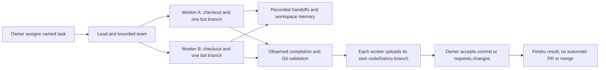

# Editor, messages and bounded teams

The preview restores useful parts of the original editor and collaboration
workflow. The runtime stays GitHub-only. New bots each use one permanent branch
for code and Markdown records; named tasks stay on it. Existing bots preserve
their earlier layout. No command
creates a PR, merges a branch or changes the default branch.

For fixed bot-to-bot information requests, delivery receipts and replies, use
the [communication protocol](BOT_COMMUNICATION.md). Team handoffs stay reference
notes; explicit task assignment and owner acceptance retain the boundaries below.

## Editor dashboard and setup

The **Intern Agent** Explorer tree groups conversations and teams by workspace.
Conversation rows show Idle/Working mode, activity and Git synchronization.
Expand a row for its task, code branch, model and state. Context actions open
Feishu, stop/pause/resume, manage tasks, compact context, show usage, restart
context or archive a conversation. Commands enter the existing durable relay
queue; the editor does not execute a second agent implementation. `/stop` enters
the separate urgent path.

**Check Setup** / `/doctor` checks Linux, Python, dependencies, Git, tmux, Codex
configuration/login presence, private credentials, pairing, receiver freshness,
tracked workspaces, Git guard hashes, completed Feishu round trips and pending
uploads. It also checks native and remote-console transcript observation errors:
a connected receiver alone cannot hide a broken completion watcher. It proposes
repairs without installing packages or changing accounts.
Credential-file presence and receiver connectivity do not prove every account
permission is available. The diagnostic explicitly reports that limit.

The tree refreshes when opened and while visible. It does not start services,
create chats or alter repositories on refresh. Mutating editor actions require
workspace trust. The extension still runs on the Linux Remote SSH host; native
Windows backend support is separate future work.

The 0.7.0 preview adds [new private project initialization](PROJECT_INIT.md),
including repository/step review, durable progress and opening the bot's own
working branch. [Frontend comparison](FRONTEND_COMPARISON.md) lists the remaining
differences from the original editor interface.

## Messages, context and usage

`/progress summary` (default) updates one message with public assistant prose and
uploading milestones, omitting tools and private reasoning; `/progress messages`
keeps separate updates;
`/progress off` disables them for a conversation. Notices are independent of the
agent/interrupt workers. Failed notices do not replay execution or block `/stop`.
Reasoning and raw tool output are not forwarded. Approval questions continue to
use the existing explicit approval channel. The final result is still saved and
validated/uploaded before its final Feishu reply.

Input supports plain text, rich text with text/links/images, up to four images,
and PDF, ZIP, image and UTF-8 text/source attachments. Each resource is at most
20 MiB. Binary Office, audio, video and sticker inputs receive an unsupported-format reply; they
are not silently discarded or executed. Malformed events and unauthorized
senders are rejected. Downloaded resources use private 0700 directories and
0600 files, are verified by SHA256 on reuse and are not automatically committed.
File-size metadata is checked when supplied; the download transport streams
bytes and stops at the local limit. ZIP paths and expanded sizes are checked
without automatic extraction. See [file transfer](FILE_TRANSFER.md).

Isolated Codex conversations receive images as structured `localImage` input.
The attached terminal receives private attachment paths as reference data and
can inspect them with its existing tools. Successful downloads add filenames
and hashes to the turn evidence, not private resource keys/paths to Git.
Download failure returns an actionable reply before Codex starts.

`/send-file RELATIVE_PATH` queues a snapshot of a regular workspace file,
including uncommitted results. `--committed` selects Git HEAD. It rejects
outside/dot paths, private configuration, symlinks, credentials and files over
20 MiB. The independent delivery worker saves upload keys and message receipts;
`/files` and `/files retry TRANSFER_ID` inspect/recover deliveries. Codex can also
use the bundled skill when the owner explicitly asks for a file. Merely
mentioning a path does not export it.

`/compact` waits for observed Codex compaction completion. `/clear` or `/restart`
starts fresh Codex context while preserving the workspace, selected task and
Git history. A reset prepares a hidden candidate view, verifies readiness and
observation, then switches the console. A failed preparation preserves the old
thread, view and transcript cursor. Typed drafts and busy/unverified candidates
are preserved for inspection; they are never discarded automatically. Avoid
typing into the original console while explicitly resetting its context.
`/archive` requires idle, reconciled work with no selected task;
it preserves the group and branches. `/unarchive` restores the same conversation.
The attached Debug Bot requires context/model changes in its original terminal
and cannot be restarted/archived through these commands.

`/usage` (alias `/cost`) reports observed Codex token counts and account limit
windows. It does not invent monetary prices or quota remaining. Counts require
app-server token notifications; the attached terminal does not claim token
telemetry it has not observed.

`/goal OBJECTIVE`, `/goal set [TOKEN_BUDGET] OBJECTIVE`, `/goal`,
`/goal pause|resume|clear` and `/goal auto on|off` manage persistent goals.
Semantic selection uses the current owner's actual request. Every continuation
uses the normal observed/stoppable/recorded turn pipeline and waits for Git
upload and reply delivery; the native objective is held paused as that gate.
Long background experiments use the separate [research wake-up pipeline](AUTORESEARCH.md).
See [goals and answer cards](GOALS_AND_QUESTIONS.md) for lifecycle, evidence,
budgets, native compatibility and required Feishu callback configuration.

## Team workflow

Teams contain one lead and one to three workers. Each member is a registered
conversation in the **same Git workspace**, with its own tracked code checkout.
The attached Debug Bot stays independent. Creating a team does not create
agents, recursively delegate, grant approvals or run prompts.

```text
/new-session PROJECT
/new-session PROJECT
/list
/team create "Parser work" PROJECT LEAD_SESSION 2
/team add TEAM_ID WORKER_SESSION
/task WORKER_SESSION start Fix parser
/task WORKER_SESSION pause
/task WORKER_SESSION list
/team assign TEAM_ID WORKER_SESSION TASK_ID
/team mail TEAM_ID LEAD_SESSION WORKER_SESSION Review parser boundary cases
/team run TEAM_ID WORKER_SESSION Implement the assigned parser task and verify it
/team status
/team accept TEAM_ID TASK_ID Verified the uploaded implementation and tests
```

Use IDs returned by the preceding commands; these example placeholders are not
defaults. Worker tasks must be explicitly created and assigned. `/team run`
rejects a worker with running, queued, unresolved or already-delivered work.
Workers may also receive normal authorized messages in their workspace chats.
Registered bots on distinct checkouts and branches can run in parallel, whether
they are team workers, leads or ordinary conversations. Each conversation has
its own input worker, so unrelated tasks cannot exhaust a shared three-worker
pool. Team membership, explicit assignment and configured team limits still
govern team work; they do not block another conversation's ordinary messages.

`/team mail TEAM FROM_SESSION TO_SESSION TEXT` creates a durable handoff.
Unread notes enter the recipient's next-turn memory as reference data; they
never execute themselves. `/team read TEAM MAIL_ID` marks one read.
The same reference channel supplies concise lead/worker responsibilities.
Workers report their delivery commit, verification commands/results, untested
limits and blockers; leads review that evidence and report decisions needed
from the owner. These references do not rewrite owner prompts or authorize
additional worker execution.

Assignment states are Assigned → Delivered → Accepted, or Changes requested.
Delivered requires observed successful Codex completion and synchronized records.
`/team accept` uses the existing `/task finish` gate: verified completion, recorded
delivery commit, clean branch and matching remote HEAD. Acceptance records a
commit and owner note; it does not merge. `/team changes TEAM TASK_ID NOTE`
records requested revisions. Accepted receipts cannot be rewritten. Team
archival requires idle members and accepted assignments; archived membership
and handoffs remain in history. Conversations can join a subsequent active team.



## Human collaborators

The owner alone manages teams, new sessions, lifecycle resets, exports and
workspace access in the management group. `/access grant OPEN_ID PROJECT
operator|viewer` gives explicit local workspace access; `/access revoke OPEN_ID
PROJECT` removes it. Open IDs are private local account routing, not distributed
defaults or portable Git recovery data. Queued actions recheck authorization;
use `/stop` to interrupt an already-running turn.

Viewers can read help/status/usage/model information but cannot start Codex or
change settings. Operators can send prompts and manage tasks, ordinary notes,
models, stops and approvals in their allowed workspace chats. They cannot grant
access, edit owner instruction rules, manage teams or create new workspaces.
An operator approval can affect only that workspace conversation's request.

Feishu app availability and group membership are separate prerequisites. The
current owner-only publication is preserved. No collaborator has been granted
access or added to a group by this release, and no repository sharing changed.

## Recovery and release limits

Conversation/task event lists use bounded Markdown history pages while keeping
existing prefixes append-only. Recovery archives above 256 KiB use 128 KiB
content-addressed JSON parts, each verified by size and SHA256, with a 64 MiB
total ceiling. Old single-file v1 archives remain supported. Git commit/push
guards validate all referenced parts against the Markdown records. Recovery
restores teams, assignments and handoffs, but no credentials, account access,
chat/thread routing or executable queue entries.

The 0.5.0 observations above describe a historical development preview. The
current MIT product has a separate stable identity and versioned source, VSIX
and complete skills; see [installation](INSTALL.md) and [distribution](DISTRIBUTION.md).
Real editor UI acceptance, new Feishu attachment permissions/account pilots,
invited-human collaboration, provider adapters and multi-machine supervision
remain separate acceptance or future work. Automatic
upgrades, global approval bypasses, credential backups, forced deletion and
Codeup defaults have not been restored.

## Further comparison with the surviving enterprise reference

The surviving reference is 1.6.1, documenting the 1.6.0 enterprise line; an exact
1.6.0 package has not been located. This is a source comparison, not a claim
that the historical runtime was restarted or retested.

Useful remaining candidates, in recommended order:

| Reference capability | Current behavior | Recommendation |
|---|---|---|
| Editable in-progress Feishu message, summary/full modes | Durable public-prose notices plus final reply; tools and private reasoning omitted | Add one bounded editable progress message to reduce chat clutter, retaining prose-only output and final-delivery receipts. Requires verification of the message-update API. |
| All-message or mention-only trigger per chat | Authorized workspace-group messages are accepted without requiring a mention | Add opt-in mention-only mode before expanding human collaboration; default dedicated owner chats can keep all-message behavior. Preserve incoming text after transport-token removal. |
| Shared repository/personal skill catalog, enabled per intern | Codex's existing skills can be used; relay has no portable shared-skill manager | Add a version-pinned, explicitly enabled catalog with provenance and per-workspace scope. Do not automatically update or execute skills. |
| Coordinator/lead/worker hierarchy, task documents and mailbox | One lead, up to three workers, explicit named tasks, durable handoffs and owner acceptance | Keep the bounded hierarchy. Strengthen task criteria and verification evidence, rather than restoring recursive spawning or automatic PR/merge playbooks. Role guidance now enters the existing reference channel. |
| Setup repair and client upgrade actions | Read-only doctor, reviewed runtime snapshots and explicit relay launch | Add reviewed repair previews and rollback/clean-install acceptance. Do not restore global package upgrades or approval bypasses. |
| Multiple provider adapters and host supervision | Codex-only Linux relay; separate tmux host per bot | Defer until one-provider recovery and Remote SSH packaging are accepted. Never silently recreate an unreachable host or replay uncertain prompts. |

The old stop/session hooks support the value of independent lifecycle recording,
but their fail-open exception handling and intrusive output checklists should
not return. The current pipeline validates stored Markdown and Git deliveries;
ordinary user prompts and natural final replies remain unchanged. Old Codeup
defaults, credential backups, automatic merges, mandatory second branches and
untracked autonomous goal loops remain retired. Persistent goals now use the
same Git and delivery boundary as ordinary work.
