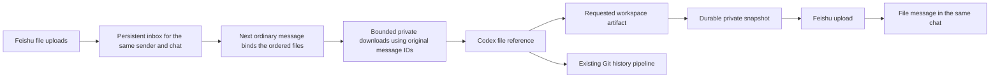

# Feishu file transfer

Use the same project, Debug Bot or Control conversation you already use for
text. Incoming ordinary files of any extension are accepted, including PDF,
Word, Markdown, TXT, ZIP and images, up to **20 MiB per file**. No new bot,
workspace or repository is needed. Reading a format still depends on Codex's
available tools; accepting its bytes does not install a parser or execute it.

All registered conversations use the same file courier. Published permissions
belong to the Feishu app and apply to its existing and future chats; they are
not granted separately for each Codex session. Each conversation's private
thread-bound context sends files only to its own chat. Older saved references
can be refreshed without new prompts or restarting a session. Native automatic
context injection requires a trusted submit hook. See [session coverage](SESSION_FEATURES.md).

## Send a file to Codex

1. Upload your files to the bot's Feishu chat: **file1, file2, file3**. Each
   upload waits privately; an upload alone never starts a Codex turn.
2. After all uploads, send your **message**, for example: “Compare the attached
   paper with our current approach” or “Inspect this ZIP's source files.”
3. Codex receives the actual private local file, with its filename and extension,
   rather than an inaccessible Feishu URL. Images also use structured image
   input in isolated Codex sessions.

The next ordinary message and preceding uploads become **one request**.
The relay keeps your text unchanged and supplies file paths/hashes as separate
untrusted hook reference data. Upload order and original filenames are retained,
including repeated filenames. A captioned rich-text post also submits waiting
uploads before its own images. Files are not automatically copied into the
project or uploaded to GitHub.

Uploads are separated by app, conversation, Codex thread, chat and sender. They
survive relay restarts and never expire into an automatic Codex request. Commands
such as `/status`, `/model`, `/help` and `/send-file` leave them waiting. Use
`/files pending` to list your uploads or `/files clear` to discard them. A new
Codex thread cannot silently consume an old thread's uploads; the list labels
those leftovers so you can clear and re-upload them. Already submitted batches
remain attached to their original request, even if downloading fails.

If Codex is already working, files plus message wait as a single batch until
that turn finishes; they do not interrupt it or become ordinary live text
steering. This rule is shared by existing and future registered project bots,
Control, Recovery Sentinel and the attached native Debug Bot.

ZIPs are validated but never extracted or executed automatically. Paths must be
relative; links, special files, encrypted entries and duplicate names are
rejected. An archive may contain at most 1000 entries, 100 MiB expanded data and
a 200:1 compression ratio per entry. PDF signatures are checked; the relay does
not render PDFs or perform OCR. Codex uses its available document tools.

Word and other Office files stay in their original format. Modern Office/ODF
containers receive the same bounded ZIP validation; legacy Office and RTF
signatures are checked. Unknown incoming types are stored as opaque private
bytes. Feishu cloud-document links, folders, media messages and stickers are
separate message types; upload an actual file rather than a cloud link.

## Receive a file from Codex

Ask in natural language:

```text
Create the report as a PDF and send it here.
Send the results and their README as a ZIP file.
```

The workspace hook tells Codex how to queue files to that conversation. The
bundled [file-transfer skill](../skills/feishu-file-transfer/SKILL.md) explains
inspection, sending, receipt checks and recovery. It uses the existing relay
and private conversation context; no extra account credentials are needed.

You can also send a known project file explicitly:

```text
/send-file reports/report.pdf
/send-file "exports/result bundle.zip"
/send-file --committed reports/report.pdf
/files
/files pending
/files clear
/files permissions
/files TRANSFER_ID
/files retry TRANSFER_ID
/help files
```

Outgoing supported formats remain PDF, ZIP, Office/ODF documents, images and
UTF-8 text/source files; accepting arbitrary incoming files does not enable
arbitrary binary exports. The default sends a snapshot of the **current workspace file**, including
uncommitted results. `--committed` selects the version in Git HEAD. Control's
commands default to its own workspace; use `/send-file SESSION RELATIVE_PATH`
or `/files SESSION` there to select another bot explicitly. Export stays
owner-only, including when an operator has access to ordinary project work.

The file must be a regular file inside the bound workspace. Outside paths,
symlinks, dot/private paths, configuration and recognizable credential material
are rejected. ZIP members are also inspected for private paths and credentials.
Do not package the entire checkout with `.git` or `.env`. A generated artifact
can be sent without committing it. Existing Git artifact limits still apply
separately; an ignored output folder is appropriate for larger delivery-only
artifacts. ZIP artifacts that are intentionally tracked now receive the same
archive validation before a Git commit.

## Delivery and recovery



File delivery has a separate worker and does not wait for Git publication.
Each snapshot records its filename, hash, byte size, upload key and receipt in
private relay state. `/files` exposes status and a transfer ID, without secrets,
resource keys or private paths. `queued` means saved for delivery; `delivered`
means Feishu returned a message receipt. Files sent during a tracked turn add
filename/hash delivery evidence to its history.

`/files permissions` queries the current app's tenant grants without changing
them. It checks upload, incoming-resource read and message-send permissions
separately. A failed diagnostic is **unknown**, not evidence that a scope is
missing; a successful scope check still does not establish a file round-trip.
Bots have the same read-only `file-permissions --context` interface in their
workspace hook.

Repeated submissions of the same artifact in one turn reuse the existing
transfer. Changing the filename or requesting it in a new turn creates a new
delivery. Upload transport failures and confirmed rate limits get up to three
attempts. Permission/content failures require repair. After a restart, an
unacknowledged upload can resume, but an interrupted or transport-failed message
send becomes `uncertain`: it may already have arrived. Check the chat before
using `/files retry TRANSFER_ID`; a late retry can create a duplicate outside
Feishu's message deduplication window. Retrying uses the saved bytes and upload
key, and does not rerun Codex. Failures produce an actionable Feishu notice.

For API `99991672` or `99991676`, inspect the failed operation: an **upload**
needs `im:resource:upload` or `im:resource`; a **file-message send** needs
`im:message:send_as_bot`; an incoming-resource **download** needs
`im:message:readonly`. The status includes the operation and required permission,
including older saved permission failures. Invalid-token and network errors
are not labelled missing upload permission. Publishing the corrected app
permission is necessary before retrying the existing snapshot. A bot must not
claim successful delivery based on installed code, a queue entry or grants alone.

Cached input and output files live on the configured private data volume, with
0700 directories and 0600 files. They remain available for continued inspection
and explicit retries. This release does not automatically delete historical
attachment snapshots; they are private local state, excluded from packages and
Git by default.

## Feishu application permissions

Grant **tenant/application** permissions to the existing Intern Agent app:

- `im:message:readonly` to download resources attached to received messages.
- `im:resource:upload` to upload result files. If the console does not offer this
  narrower scope, `im:resource` is the combined resource alternative.
- `im:message:send_as_bot` to send the file message; the existing app has this.

Publish an approved permission change before testing the live bot. Keep its
owner-only availability and external sharing settings unchanged. File transfer
uses the existing `im.message.receive_v1` event; no new event subscription,
callback, user login grant or webhook is needed.

Check the actual installation with `/files permissions`; installed backend code
does not grant app permissions. Local tests do not prove a human file round-trip.
Once granted, verify one small PDF and ZIP sent to Codex, then one generated PDF
and ZIP returned to the same chat. Preserve the existing app, credentials,
availability and event subscriptions while correcting its scopes.

Primary references: [Feishu resource-download guide](https://github.com/larksuite/cli/blob/main/skills/lark-im/references/lark-im-messages-resources-download.md),
[upload API](https://open.feishu.cn/document/server-docs/im-v1/file/create), and
[message-send guide](https://github.com/larksuite/cli/blob/main/skills/lark-im/references/lark-im-messages-send.md).
