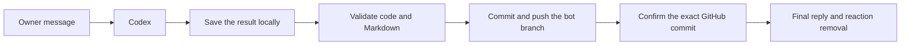

# Turn completion and GitHub uploads

A completed Codex response and a completed Intern Agent turn are different
events. A normal turn finishes only after the code and its validated Markdown
history are uploaded to the registered GitHub branches and that exact records
commit is confirmed on GitHub. The official final reply follows that check.
The thinking reaction stays until completion and reply delivery. `/stop` and
explicit cancellation remain separate outcomes.

Public commentary and interim answers to live follow-ups can appear earlier.
They are progress, not a completion receipt. The existing terminal keeps its
history; the relay never rewrites the owner's prompt to manage uploads.

## Check a delay

Use `/status` in the affected chat. It distinguishes a message still in Git
preflight, actual Codex execution, final Git publication and Feishu delivery.
An upload failure includes its saved blocker, attempt count and next Git-only
retry time. Transient failures back off from 30 seconds to at most five minutes;
unsafe changes and validation failures retain explicit review. Do not resend
the prompt: retrying Git uses the saved result, never another Codex execution.

Errors distinguish network/server transport from local locks, format/privacy
validation, authentication/access and a changed remote branch. A network retry
cannot repair a local review or grant repository access. Raw Git stderr and
credential-bearing URLs are not copied into chat.

Progress reports the first upload stage and the first pending-upload stage once
per turn. Alternating retries do not generate another stream of notices.
Unknown execution or uncertain message delivery still requires reconciliation.
Old reply-outbox callbacks cannot put an uploaded turn back into a pending-Git
phase. They are normalized only after a positive upload acknowledgement.
Previously delivered historical reviews remain preserved; their existence does
not turn a later answer into a successful upload or waive its own preflight.

## Keep uploads small and fast

Before dispatch in a uniquely owned bot worktree, the relay saves private
before-images of existing drafts. Later edits can then be recorded without
mistaking the bot's unfinished draft for another person's work. Unchanged
drafts are not uploaded. The original starting hashes remain immutable.
Snapshots are local, content-addressed, and excluded from Git and distribution;
they do not create another branch. Limits are 512 files, 10 MiB per file and
64 MiB per turn, with source/text files prioritized. Links, private directories
and uncaptured overlaps retain review. Shared/native workspaces stay strict;
staged owner code in a bot worktree stops dispatch before Codex starts.

Old turns can recover before-images from an existing backup only when its bytes
exactly match the original hash. Otherwise an operator needs a current owner
repair request and a bounded review of exact current files. That review keeps
the original event, baseline and review privately, limits publication to the
reviewed hashes, and becomes invalid if those files change. It neither invents
old bytes nor replays Codex. Read-only peer information turns publish their
correspondence records without staging background research artifacts.

New turns persist their input and baseline locally before invoking Codex; they
do not first push a temporary “running” snapshot. The final publication carries
code, the response and a complete record in the same upload. Existing legacy
code/management branch layouts still use their atomic branch upload. New bots
retain their single permanent branch. No automatic PR, merge or force push is
introduced.

Git guards read objects through one bounded local reader. A private validation
proof can reuse an already checked ancestor only under the same registered
rules and base commit. New commits, including added-then-deleted files, remain
checked. Changed rules, a changed base, or rewritten ancestry require a fresh
audit. A validation proof is not evidence that GitHub received a push; remote
confirmation is a separate step.

Original repositories can contain older enterprise records and shared skill
dependencies. Exact, unchanged files inherited from the default branch stay
intact; they are not new relay output. Changed records must pass the current
privacy rules. Inherited skill links and submodules are treated as opaque
dependencies and are never followed; new or changed links remain blocked.

Recovery snapshots reference content-addressed JSON chunks. Superseded chunks
already committed to Git are removed from the current checkout after writing
the replacement manifest. Old commits retain their original chunks and can
still restore them. Modified, linked, untracked or unrecognized files are not
silently deleted. This does not rewrite history or erase old reviews.

Completed historical terminal observations with no original dispatch/baseline
can share one records-only upload, including positively associated completed
follow-ups. Their missing code baselines stay missing; the relay does not stage
current research files, rerun prompts, or invent proof of earlier code changes.
Existing blocked or unconfirmed reviews are excluded from that consolidation.

Per-bot status work targets that bot's actual branch. It cannot publish through
the parent workspace template, touch a default branch, or monopolize a running
Codex session. Redundant post-completion uploads are avoided when the confirmed
final record is already on GitHub.
