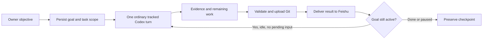

# Persistent goals and Feishu questions

Use a goal for an outcome that needs repeated investigation or improvement:
optimize a measured benchmark, debug until the regression suite passes, or
produce a research artifact with an evidence-backed audit. Ordinary questions
and small edits remain ordinary messages. Your original message is sent intact;
the application hook supplies the goal policy and saved references separately.

## Start and manage a goal

```text
/goal Reduce parser p95 below 120 ms while keeping correctness tests green
/goal
/goal pause
/goal resume
/goal clear
/goal auto off
/goal auto on
```

`/goal set OBJECTIVE` also works. An explicitly requested token budget can be
specified as `/goal set 40000 OBJECTIVE`; no token budget is invented otherwise.
The VS Code **Manage Persistent Goal** command provides the same controls.

Semantic goal selection is enabled by default. The current Codex model decides
whether the owner's request calls for sustained work with a verifiable finish
line. It uses a context-bound tool to record that objective, not a keyword
classifier or another inference conversation. Quotes, attachments, peer notes,
release jobs, recovery incidents and research alarms cannot authorize new goals.
An existing paused goal is never silently replaced or resumed. The automatic
selection setting is recoverable with conversation preferences.

A useful goal specifies the outcome, evidence and constraints. When the actual
finish line is unclear, Codex should ask a structured question. When the goal
finishes, it must report evidence, remaining uncertainty and any unmet condition.

## How continuation works



Each iteration uses the existing workspace, branch, task, question, recovery,
Git and reply pipeline. It is not a second terminal or a replay of the last
prompt. An iteration gets one durable identity and never reruns merely because
Git or Feishu delivery needs retrying. New owner messages take priority over
queued goal work, and can steer an already running turn through normal steering.
Other conversations remain independent.

Where the Codex App Server is available, the relay mirrors the objective to
native Codex goal state. That mirror is deliberately held paused: activating
the native dispatcher can start another turn before relay publication finishes.
Feishu `/goal` reports the **relay goal lifecycle**, progress and native
publication gate explicitly. Attached native Debug terminals use the same
tracked continuation adapter without launching a replacement Codex. Use the
Feishu/VS Code controls for this pipeline; a separately typed native TUI `/goal`
is outside this scheduling contract.

Goals stay attached to their selected task and branch. Switching to another
task yields the old goal rather than continuing it in the wrong context.
`/goal pause` stops future iterations; `/stop` also interrupts the current turn
and cancels queued continuations. Session pause pauses its goal. Resume is an
explicit owner action. A completed goal is not automatically restarted.

Budgets use observed per-run token boundaries. Missing or reset counters make
budget accounting unavailable; a budgeted goal yields instead of pretending
its usage is zero or continuing without a verified limit. Completion is distinct
from budget exhaustion. A continuation with no tool activity yields to avoid
spinning. Three distinct turns reporting the same concrete blocker can mark a
goal blocked. A network/capacity failure stays with the existing recovery
pipeline; it does not start a parallel retry or contact manual Debug Bot.

The optional relay token budget is checked at recorded turn boundaries. An
in-flight turn can exceed it; this is not a server-enforced per-request token
cap. Resume does not reset its accounting or extend an exhausted budget.

For an experiment expected to take ten hours, Codex should save a waiting
checkpoint with the actual estimate and evidence, then use the persistent
research alarm. It must not keep a sleeping inference turn alive or launch
duplicate experiments. Waiting for missing owner input also suppresses another
automatic iteration.

## A resumed goal produces no new turn

Check `/goal` and `/status` before resending work. A goal waits for its prior
result, confirmed Git upload, reply delivery and any actual unfinished work or
question in the same conversation. A historical Fast command with an exact
conversation-specific verified receipt does not represent unfinished Codex
work, even if its original execution review remains retained. The scheduler
checks this both before and inside the continuation transaction, queues one
normal tracked continuation and never replays that settings command. Missing,
unverified or foreign-conversation receipts do not bypass a review; neither do
verified settings bypass real agent uncertainty or pending Git/reply delivery.

## Answer questions in Feishu

When Codex requests input, the relay sends a card containing the full questions,
option descriptions, selectable choices and custom-answer fields. Single-choice
questions remain single-choice; requests allowing several selections get a
multi-select control. A multi-question request is submitted as one correlated
answer, preserving each question ID. Recommended options are never selected or
submitted automatically, including with full-access execution enabled.

You can also answer in chat:

```text
/questions
/answer REQUEST_CODE My custom answer
/answer REQUEST_CODE {"dataset":"Small","split":"Dev"}
/answer REQUEST_CODE {"datasets":["Small","Full"],"split":"Dev"}
```

The array form applies only to a question allowing multiple selections. Numeric
answers select the numbered option. Plain text answers one question at a time;
it is never copied to all questions. If exactly one blocking request is pending
in the current chat, an ordinary text reply is treated as its answer. Commands
retain their normal meaning. For non-blocking questions use the card or
`/answer`, so ordinary messages can still steer work.
If files are waiting for your next message, that message remains their caption;
answer the question separately with its card or `/answer`.

Requests and answers are saved before delivery. Cards check the app, owner,
conversation, exact message and request. Duplicates are idempotent; resolved,
expired and foreign requests cannot be answered. Native transcript and RPC
observations of the same question share one card. A missing request channel can
use only its exact verified remaining native question menu. Ambiguous partial
terminal or socket submission is retained for review, never blindly replayed.
Questions expire after six hours. Secrets require secure local input rather
than a Feishu text field.

An attached client's asynchronous question does not hold an RPC request open.
Its card answer becomes one durable owner follow-up in the same conversation,
using normal steering if that terminal is still busy. The card reports that it
was queued; a transport acknowledgement is not treated as an owner answer.

Attached/older clients can use the context-bound `ask --context CONTEXT_FILE`
backend command, with a questions object on JSON stdin. It waits for the same
durable Feishu answer instead of driving a terminal menu. Built-in requests
remain supported. Completed non-secret choices are saved as readable decision
Markdown; private widget routes and secrets stay outside Git. Pending questions
must be answered or stopped before changing their task/conversation.

## Feishu account configuration

In the app console, open **Events and Callbacks → Callback configuration**.
Choose **receive callbacks by long connection** and subscribe to
`card.action.trigger` (**卡片回传交互**, the current callback). Publish the change
with the existing intended access range. Keep `im.message.receive_v1` for normal
messages. Existing send-as-bot/message-update scopes cover the card transport;
this feature does not require group administration scopes or an HTTP server.

Do not confuse callback configuration with the ordinary event list or the older
`card.action.trigger_v1` callback. Until the current callback is published,
`/answer` remains available even if the card displays successfully.

## Git recovery and limits

Goal definitions, progress, task scope and semantic-selection preferences are
validated Markdown/portable archive data. Cold import does not execute old work;
an owner reconnects the conversation and explicitly resumes the saved goal.
Private live question routes/socket handles are not exported as executable
recovery data. Existing pending questions survive a receiver state restart;
their actual transport/menu must still exist before an answer can be submitted.

Implementation references:
[official Codex Goals](https://developers.openai.com/cookbook/examples/codex/using_goals_in_codex),
[Codex App Server](https://learn.chatgpt.com/docs/app-server),
[Feishu card callback](https://open.feishu.cn/document/feishu-cards/card-callback-communication).
The original 1.6.1 enterprise-line lifecycle was used as a behavior reference;
enterprise source snapshots and Codeup are not part of this implementation.
